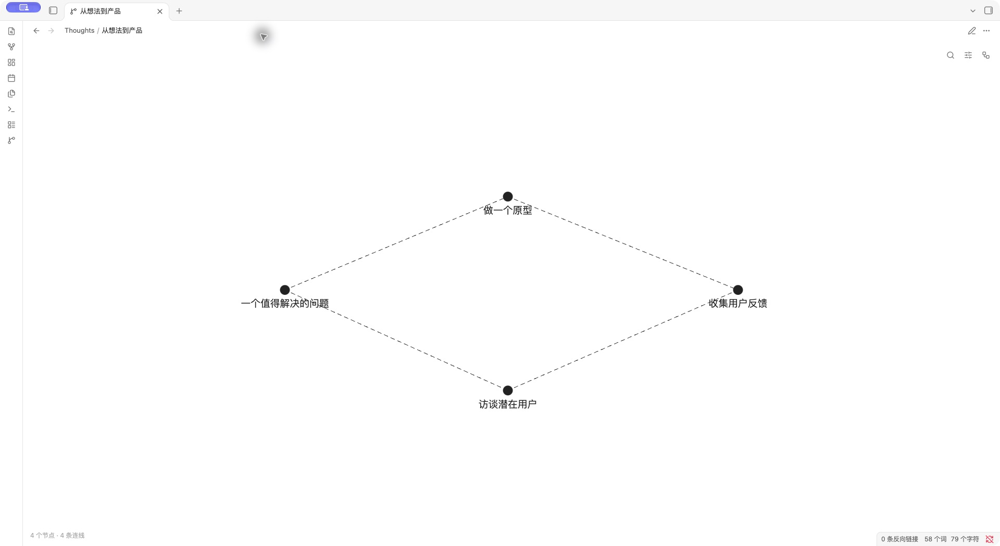
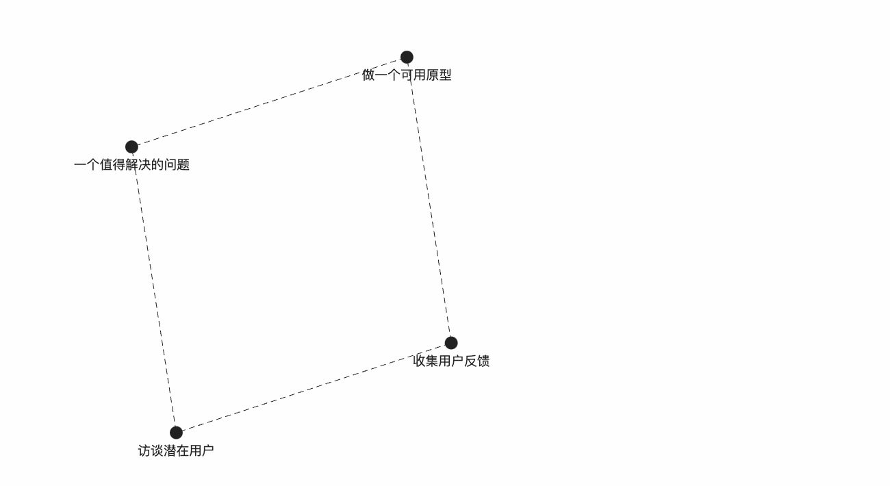

# BrainOS Graph

Record thought paths in plain Markdown and explore them as an editable graph. Each thought is a normal Markdown file, so your notes stay readable without the plugin.

[中文文档](README.zh-CN.md)

## See it in Obsidian

Actual captures of BrainOS Graph 0.2.6 running in Obsidian 1.14.4 on macOS, using a separate demo vault and the default light theme.



### Edit titles and reuse nodes

Select a node and press **Space** to edit its title in place. Press **Tab** to extend the path, then type to find and reuse an existing node. The recording finishes with the same four nodes, without creating a duplicate feedback node.



The GIF uses real app captures, cropped and paced for readability. No application UI is generated or composited.

### Live node suggestions

Suggestions contain nodes from the configured thought folder; the source file helps distinguish matching titles.


## Installation

Requires Obsidian 1.7.2 or later. See the [community listing](https://community.obsidian.md/plugins/brainos-graph). If the plugin has not appeared in your app's directory yet, install it manually:

1. Download `main.js`, `manifest.json`, and `styles.css` from [the latest release](https://github.com/Radical7VII/brainos-obsidian/releases/latest).
2. Create `.obsidian/plugins/brainos-graph/` inside your vault and place the three files there.
3. Reload Obsidian and enable **BrainOS Graph** in Settings → Community plugins.

When updating manually, keep your existing `data.json`.

## Usage

Set a thought folder in the plugin settings to limit the shared graph and node suggestions to Markdown files in that folder and its subfolders. An empty setting includes the whole vault.

Run **新建思考** (New thought) from the command palette or the new-tab page. Create nodes by double-clicking empty canvas space. Each thought belongs to one Markdown file, while the canvas shows all thoughts in the configured folder. Hover over a file in the file explorer to preview its path.

| Action | Shortcut or gesture |
| --- | --- |
| Edit the selected node title | Space or double-click the node |
| Extend a path | Tab |
| Start a branch | Enter |
| Insert a node between the selected node and its parent | Command/Ctrl+Enter |
| Move a node | Drag the node |
| Select several nodes | Drag empty canvas space |
| Delete selected nodes | Backspace/Delete |
| Disconnect an edge | Hover to highlight, then click |
| Pan the canvas | Right-button drag, or two-finger trackpad scrolling |
| Undo / redo | Command/Ctrl+Z / Command/Ctrl+Shift+Z |

Type a node title to see matching nodes from the thought folder. Choose an existing node to reuse it or reference one from another file. Edit body text in the Markdown view. Flowing dashed edges indicate direction. Selecting a node temporarily expands the active thought into a reading layout; click empty space or press Escape to return to the free layout.

## Markdown format

```md
- First idea
  Optional body text belongs to this visit.
- Second idea

---

- First idea
- Another branch
```

Top-level list items are node visits. Consecutive items form directed edges. A horizontal rule starts a separate path. Repeated titles reuse a node within the same file; identical titles in different files are independent. Node bodies are indented by two spaces and remain attached to individual visits.

An explicit cross-file node reference looks like `- [[Other thought.md|Node title]]`. The alias identifies the node inside that file. Content and connections are reconstructed from Markdown; stored coordinates are only auxiliary layout data.

## Privacy

All note processing and layout calculations stay local. The plugin requires no account, network service, or telemetry. It enumerates vault file paths to find thoughts and reads the configured Markdown files through the Obsidian API. Graph edits modify those files; keep normal vault backups. The optional vault-links graph uses Obsidian's metadata cache.

## Development

Use Node.js 22 and the committed lockfile:

```sh
npm ci
npm run lint
npm test
npm run build
```

The build outputs `main.js` in the repository root. Tagged releases are built and tested by GitHub Actions, checked against the committed bundle, and published with artifact attestations.

Some native interface integration uses internal Obsidian APIs and may be affected by Obsidian updates. Automated tests cover storage, parsing, and simulated interactions; they do not cover every device, theme, or Obsidian version. The shared canvas and file explorer integration have been tested on macOS with Obsidian 1.14.4. AI generation and process replay are not implemented; the AI provider interface sends no content.

See the [contribution guide](CONTRIBUTING.md), [changelog](CHANGELOG.md), and [graph implementation notes](docs/GRAPH_RECONSTRUCTION.md).

## License

BrainOS code is licensed under [Apache License 2.0](LICENSE). Contributors retain their copyright and license their contributions under the same terms. Commercial use is allowed subject to the license conditions.

The generated bundle contains esbuild runtime helpers under the MIT license. Their copyright and license, together with the project's Apache license, are embedded in `main.js`. See [third-party notices](THIRD_PARTY_NOTICES.md). Native Obsidian components are provided by the host application and are not bundled with this plugin.
